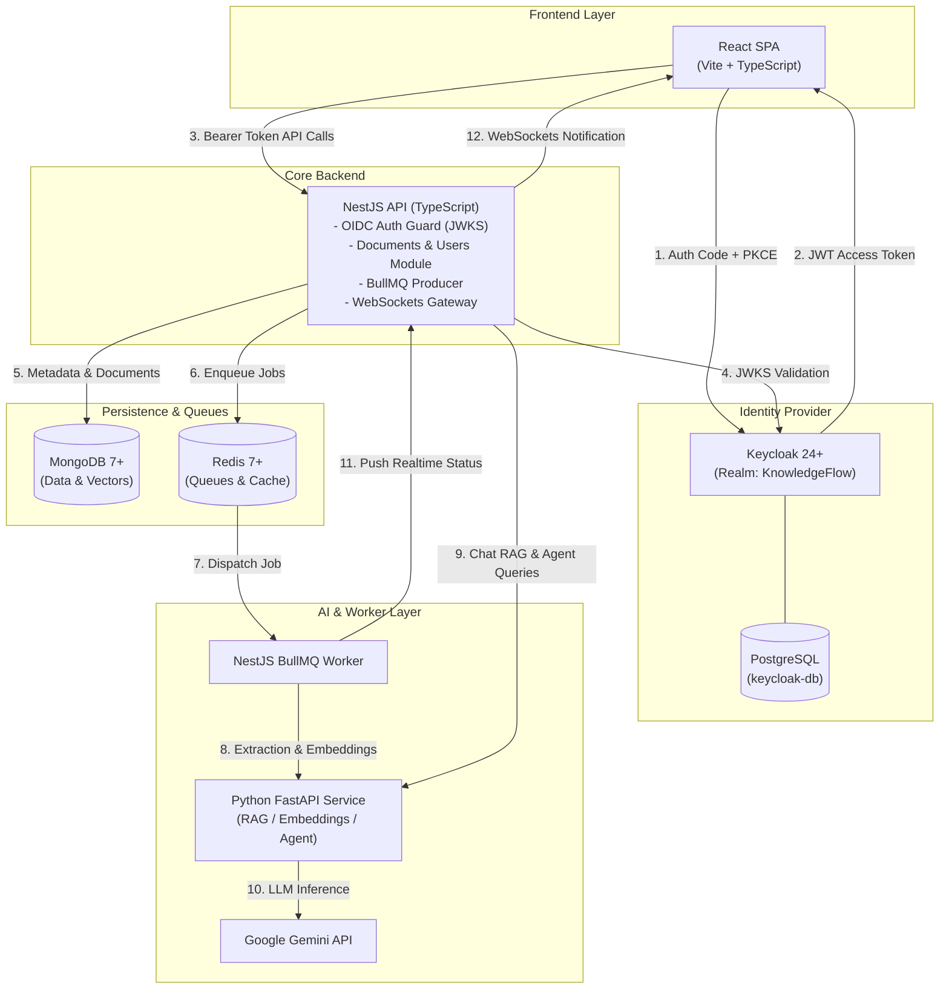

# KnowledgeFlow

> Plataforma empresarial de gestión inteligente de conocimiento con arquitectura desacoplada, RAG semántico y agentes autónomos.

---

## 1. Problema y Solución

Las organizaciones acumulan grandes volúmenes de documentos internos (manuales, reglamentos, normativas técnicas, políticas corporativas) dispersos en múltiples formatos. Encontrar respuestas precisas y corroborables consume tiempo y genera errores operativos.

**KnowledgeFlow** resuelve este desafío mediante:
* **Autenticación e Identidad Centralizada:** OpenID Connect (OIDC) mediante **Keycloak** con flujo PKCE y validación de tokens JWT basada en JWKS.
* **Procesamiento Asíncrono Resiliente:** Pipeline desacoplado con **Redis** y **BullMQ** para extracción de texto, fragmentación (chunking) y generación de embeddings.
* **Motor de IA Especializado:** Microservicio interno en **FastAPI** que interactúa con **Google Gemini** para generación de embeddings, búsqueda semántica y recuperación aumentada por generación (RAG).
* **Agentes con Tool Calling:** Capacidad de razonar y consultar herramientas internas estructuradas sin acceso arbitrario al sistema.
* **Trazabilidad y Citaciones:** Respuestas acompañadas de fragmentos de origen (`sources`) y delimitación defensiva contra inyección de instrucciones (*prompt injection*).

---

## 2. Arquitectura General



---

## 3. Stack Tecnológico

| Capa | Tecnología | Función |
| :--- | :--- | :--- |
| **Frontend** | React 18, TypeScript, Vite, TailwindCSS | Interfaz de usuario interactiva y cliente OIDC |
| **Backend Principal** | NestJS, TypeScript, Mongoose, Passport-JWT | Lógica de negocio, autorización RBAC, endpoints REST, WebSockets |
| **Microservicio IA** | Python 3.11+, FastAPI, Pydantic, Google GenAI SDK | Normalización, chunking, embeddings, RAG, tool calling de agentes |
| **Identidad / IAM** | Keycloak 24+, PostgreSQL 16 | Proveedor OIDC, gestión de usuarios, roles (`ADMIN`, `USER`) |
| **Persistencia Principal** | MongoDB 7.0 | Documentos, fragmentos vectoriales, historial de conversaciones |
| **Colas & Cache** | Redis 7.0 Alpine, BullMQ | Orquestación de procesamiento asíncrono y caché |
| **Contenedores** | Docker, Docker Compose | Orquestación local reproducible |
| **CI/CD & Calidad** | GitHub Actions, Jest, Pytest, ESLint | Integración continua, testing automatizado y typechecking |

---

## 4. Estructura del Repositorio

```text
KnowledgeFlow/
├── .github/workflows/         # Automatización CI/CD
├── backend/                   # Backend principal en NestJS
│   ├── src/
│   │   ├── auth/              # Validación OIDC, JWKS, Guards y RBAC
│   │   ├── users/             # Esquemas de usuario y sincronización de perfiles
│   │   ├── documents/         # CRUD documental, subida y estados
│   │   ├── queues/            # Productores y procesadores BullMQ
│   │   ├── chat/              # Conversaciones y mensajes
│   │   ├── search/            # Búsqueda tradicional y semántica
│   │   └── ai/                # Cliente HTTP hacia el microservicio de IA
│   ├── test/                  # Tests unitarios, integración y E2E
│   └── Dockerfile
├── frontend/                  # SPA en React + Vite + TypeScript
│   ├── src/
│   │   ├── features/          # Auth, Dashboard, Documents, Chat, Admin
│   │   ├── services/          # Clientes API REST y WebSockets
│   │   └── hooks/             # Custom hooks de autenticación y estado
│   └── Dockerfile
├── ai-service/                # Microservicio de IA en Python FastAPI
│   ├── app/
│   │   ├── api/               # Endpoints (/health, /documents/process, /embeddings, /chat)
│   │   ├── rag/               # Pipeline RAG y construcción de contexto defensivo
│   │   ├── agents/            # Herramientas (tools) y bucle de decisión del agente
│   │   └── embeddings/        # Generación de vectores con Google Gemini
│   ├── tests/                 # Tests de RAG, extracción e inyección de prompts
│   └── Dockerfile
├── infrastructure/            # Configuración de Keycloak y proxies
├── docker-compose.yml         # Orquestación de todos los contenedores
├── .env.example               # Plantilla de variables de entorno
├── PROJECT_STATUS.md          # Registro continuo del estado por fases
└── plan.md                    # Plan maestro de arquitectura y desarrollo
```

---

## 5. Requisitos Previos

* **Node.js:** `>= 20.x` (desarrollo local backend/frontend)
* **Docker & Docker Compose:** Docker Engine `24.x+` y Compose `v2.x+` (se recomienda tener Docker Desktop activo)
* **Google Gemini API Key:** Clave válida de Google AI Studio configurada en variables de entorno

---

## 6. Configuración de Variables de Entorno

Copiar la plantilla `.env.example` en la raíz como `.env`:

```bash
cp .env.example .env
```

Configurar como mínimo:
* `GEMINI_API_KEY`: Tu clave de Google Gemini.
* `INTERNAL_SERVICE_SECRET`: Secreto aleatorio compartido entre NestJS y FastAPI.

---

## 7. Ejecución con Docker Compose

Para construir y levantar todos los servicios de infraestructura y aplicaciones:

```bash
docker compose up --build
```

### Puertos Expuestos

| Servicio | URL / Puerto | Descripción |
| :--- | :--- | :--- |
| **Frontend** | `http://localhost:5173` | Aplicación Web (SPA) |
| **Backend API** | `http://localhost:3000` | API REST NestJS & Swagger en `/api/docs` |
| **Keycloak IAM** | `http://localhost:8080` | Consola de administración y endpoints OIDC |
| **AI Service** | `http://localhost:8000` | Microservicio interno de IA |
| **MongoDB** | `localhost:27017` | Base de datos principal |
| **Redis** | `localhost:6379` | Gestor de colas BullMQ |

---

## 8. Seguridad y Defensa en IA

* **Aislamiento de Privilegios:** La SPA nunca se comunica con Gemini ni con el servicio de IA de forma directa. Todo requerimiento es autenticado y autorizado por NestJS.
* **Tratamiento de Documentos como Datos:** Los textos extraídos de documentos se envuelven en bloques de contexto aislados (`<CONTEXT_DATA>`) y se instruye al modelo explícitamente para desestimar cualquier comando presente en ellos (*Indirect Prompt Injection Mitigation*).
* **Herramientas de Agente Controladas:** Las herramientas del agente tienen esquemas estrictos de entrada/salida (Pydantic / DTOs), validan permisos del usuario autenticado y prohíben comandos de shell, acceso directo a bases de datos o eliminación de registros no supervisada.
* **Control de Costos:** Se implementan límites de tamaño de archivo, fragmentación configurable con solapamiento controlado y caché de consultas repetitivas en Redis.

---

## 9. Roadmap de Desarrollo

- [x] **FASE 0:** Arquitectura, diagnóstico del sistema, docker-compose, configuración y baseline.
- [x] **FASE 1:** Backend Foundation (NestJS, Mongoose, Swagger, Health Checks).
- [x] **FASE 2:** Identity & Authentication (Keycloak OIDC, PKCE, JWKS, RBAC).
- [x] **FASE 3:** Documents Module (CRUD, Uploads, estados).
- [x] **FASE 4:** Redis + BullMQ (Colas de procesamiento e idempotencia).
- [ ] **FASE 5:** Python AI Microservice (FastAPI foundation, health y seguridad interna).
- [ ] **FASE 6:** Document Processing (Extracción y chunking de PDF, DOCX, TXT).
- [ ] **FASE 7:** Embeddings & Vector Storage.
- [ ] **FASE 8:** Pipeline RAG con citación de fuentes.
- [ ] **FASE 9:** Chat & Conversaciones contextuales.
- [ ] **FASE 10:** Agente Autónomo con Tool Calling.
- [ ] **FASE 11:** AI Security & Defensas contra Prompt Injection.
- [ ] **FASE 12:** Frontend en React (Dashboard, Gestor documental, Chat).
- [ ] **FASE 13:** Testing Integral (Jest, Pytest, AI evaluations).
- [ ] **FASE 14:** Docker Production Hardening.
- [ ] **FASE 15:** CI/CD con GitHub Actions.
- [ ] **FASE 16:** Observabilidad y métricas de costos de IA.
- [ ] **FASE 17:** Auditoría final y cierre de release.
